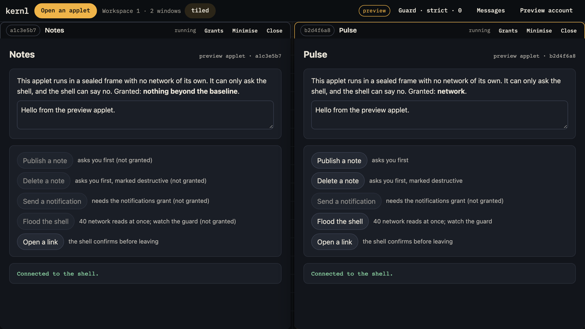
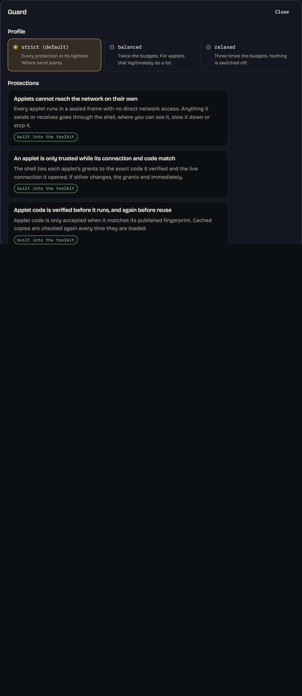

<div align="center">

<br />


# kernl

**An opinionated shell for sandboxed applets, built on [kehto](https://github.com/kehto/web).**

The person at the keyboard is the only principal that matters.


-0b0b0b)

[](./LICENSE)

[**Try the shell**](https://kernlize.github.io/app/?preview=1) · [Website](https://kernlize.github.io/) · [Docs](https://kernlize.github.io/docs/) · [Why](https://kernlize.github.io/why/)

<br />

</div>

> **Alpha.** kernl is a first draft: the guard, the contracts, the composition over kehto and the shell are real and tested; private, legacy and ratchet messages work for accounts that can encrypt (ratchet sessions are experimental), and downloads, sharing and mail only hand off to apps on your device. The source is private and the `@kernl/*` packages are not on npm yet; the [site and docs](https://kernlize.github.io/) are public. Read [`docs/alpha-status.md`](./docs/alpha-status.md) before relying on anything, and note that the badges are measured by `pnpm check` and an agent-readiness scan, not live CI.

<p align="center">
  
</p>

## What it is

kehto is an unopinionated set of packages for building a NIP-5D applet shell. It does not pick a relay library, a signer, a consent model, a layout or a deployment story. kernl picks all of them, and writes each choice down.

| kehto leaves open | kernl decides |
|---|---|
| Event layer | [applesauce](https://applesauce.build) v7, and nothing else |
| Security posture | Every mitigation kehto offers, on by default, strict profile |
| Grants | Restrictive. Applets see what the user granted, even which account is signed in, keyed by verified artifact hash |
| Consent | Writes are shown as what they change, not as JSON |
| Messaging | Any reasonable private-message protocol, described truthfully, never ranked |
| Other protocols | Bridged to one identity layer and named by what they do: downloads, sharing, mail |
| Public voice | The website never names a protocol. Protocols are plumbing; the person is the point |

The full reasoning is in [`SOUL.md`](./SOUL.md). Each concrete choice is in [`DECISIONS.md`](./DECISIONS.md).

## What it does

- **Runs applets in a sealed frame.** Verified bytes run in a `srcdoc` frame with `sandbox="allow-scripts"`, a zero-network CSP, no WebRTC and a lock against frames of their own ([D-014](./DECISIONS.md)). A browser spec tries every way out; when the host page can reach a public STUN server, it asserts that it does and that the applet produces no such candidate ([Security posture](./docs/policies/security-posture.md)).
- **Shares your account only when you say so.** An applet is not told which account is signed in until you grant "your account", and every network domain is a separate grant, keyed to the verified build ([Identity and grants](./docs/concepts/identity-and-grants.md)).
- **Asks before it signs anything destructive.** A write that replaces or erases part of your public record is shown as before → after and waits for your answer; routine writes are signed without a prompt ([Consent](./docs/concepts/identity-and-grants.md#consent-for-destructive-writes)).
- **Guards by default.** Eleven protections ship on in the strict profile: kernl drops oversized requests, bursts and requests over the smaller budget of an applet you are not using before they are handled, holds a hidden applet's requests until you can see it, and quarantines an applet that floods; kehto's runtime firewall refuses over-rate requests on top ([Guard](./docs/concepts/guard.md)). The hosted shell boots strict and only you loosen it; an embedding host may choose the starting profile, which changes limits only.
- **Messages across providers.** One messenger over several private-message providers, each described by its properties and none ranked. Private, legacy and ratchet messages work in the live shell when you sign in with an account whose signer can encrypt (browser extension, remote signer, local account). Ratchet sessions are experimental: your correspondent needs an app that speaks them, and the session keys are kept on this device, locked by your account ([Alpha status](./docs/alpha-status.md#messaging-providers-in-the-live-shell)). Group sessions are experimental too: everyone in the group needs an app that speaks them, and the group's keys change as it talks and as people join or leave ([Messaging](./docs/concepts/messaging.md#protocol-inventory)).
- **Bridges other networks.** Web fetch works behind an SSRF policy (`https` only, private addresses blocked, redirects refused in the browser). Magnet links download inside the shell page over WebRTC, with a Downloads panel to pause, resume, remove and save, or go to an app on your device if you choose that in Settings ([D-017](./DECISIONS.md)). NZB downloads, sharing and mail hand the link to an app on your device after you confirm leaving kernl, because a browser page cannot open the raw TCP sockets their protocols need; kernl connects to nothing for them ([Bridges](./docs/concepts/bridges.md#hand-off-backends)).
- **Previews without an account.** `/app/?preview=1` runs the shell offline with the core's own consent rule, kernl's guard in strict and two sample applets. Refusals before dispatch need kehto's runtime, so they happen only in the live shell ([Run the shell](./docs/tutorials/run-the-shell.md)).

<p align="center">
  
</p>

## Packages

| Package | Purpose | Docs |
|---|---|---|
| [`@kernl/guard`](./packages/guard) | Ingress flood control, visibility gating, focus-aware firewall, CSP profile, nested-frame lock, mitigation descriptions. Pure. | [guard](./docs/packages/guard.md) |
| [`@kernl/messaging`](./packages/messaging) | Provider contract, registry, composite direct-message adapter, three providers. Pure. | [messaging](./docs/packages/messaging.md) |
| [`@kernl/bridges`](./packages/bridges) | Locator parsing, bridge contract, registry, HTTP bridge with SSRF policy, backend interfaces, hand-off backends, in-page download backend. Pure. | [bridges](./docs/packages/bridges.md) |
| [`@kernl/core`](./packages/core) | Composition root over kehto and applesauce: adapters, applet resolution, mount plan, consent summaries, layouts. | [core](./docs/packages/core.md) |

Published packages have zero framework dependencies and never import `nostr-tools` directly. `pnpm check:deps` (`scripts/check-dependency-rules.mjs`) enforces both.

## Layout

```
packages/guard        @kernl/guard        pure
packages/messaging    @kernl/messaging    pure
packages/bridges      @kernl/bridges      pure
packages/core         @kernl/core         kehto + applesauce composition
apps/web              @kernl/web          Astro site at /, shell at /app/
docs                  @kernl/docs         VitePress at /docs/
features              shared step support for the package features
tests/e2e             Playwright browser suite
scripts               build, audit and guard scripts
```

## Run it

No install: [open the preview](https://kernlize.github.io/app/?preview=1). It runs the shell in your browser, offline, with the live shell's consent and guard behaviour, two sample applets and a throwaway account.

From source, for maintainers only during the alpha, because the repository is private (Node 22 or newer, pnpm 10 via `corepack enable`):

```bash
git clone https://github.com/kernlize/web.git kernl && cd kernl   # maintainers only during alpha
pnpm install
pnpm build           # the site imports the built packages
```

Then run each dev server in its own terminal:

```bash
pnpm site:dev        # landing site and shell, http://localhost:4321/app/
pnpm docs:dev        # documentation, http://localhost:5173/docs/
```

In the shell, sign in with a browser extension, a remote signer or a local account, and paste an applet's address. `pnpm docs:dev` serves the Markdown pages only, not the generated API reference; `pnpm site:build && pnpm site:preview` builds the site, the docs and the API reference into `.pages/` and serves them at `http://127.0.0.1:4178/`.

## Write an applet

Applets are ordinary NIP-5D napplets; kernl changes the posture, not the wire format. [Write an applet](./docs/tutorials/write-an-applet.md) builds one, tests it against the guard, publishes it and opens it in the shell. [Applets under kernl](./docs/concepts/applets-under-kernl.md) lists what an applet meets here and how to test against it.

## Check it

```bash
pnpm check
```

That runs, in order: build, type-check, features with 100% coverage, dependency rules, docs gate, site build, public-vocabulary scan, agent-readiness audit, slop gate. `pnpm test:e2e` adds the browser suite, and `PLAYWRIGHT_BASE_URL=https://kernlize.github.io pnpm exec playwright test` runs it against the live site. `pnpm site:publish` publishes.

## How behaviour is specified

Every behaviour is a Gherkin scenario before it is code. This is an excerpt from [`packages/guard/features/visibility.feature`](./packages/guard/features/visibility.feature); the omitted scenarios are marked with `# …`:

```gherkin
Feature: Visibility gate
  Hidden windows should not fetch or publish while the user cannot see them.
  Their traffic waits and is drained when they return; control messages are
  never held so a hidden window can still be closed or themed.

  Background:
    Given a guard visibility gate using the "strict" profile

  # … two scenarios on what the gate believes about visibility

  Scenario: hidden windows defer everything except control
    When the guard gate marks window "w1" as "hidden"
    Then the guard gate defers "relay:subscribe" for window "w1"
    And the guard gate defers "resource:bytes" for window "w1"
    And the guard gate does not defer "control" for window "w1"

  # … seven more scenarios: visible windows, draining, the full queue, forgetting a window
```

The scenarios specify the gate's own API. In the composed shell an applet's traffic travels over a port kehto owns; kernl's pipeline decides each envelope before the runtime sees it, and kehto holds a hidden window's requests until kernl releases them.

Features live in `packages/*/features/` and run inside vitest through [quickpickle](https://github.com/dnotes/quickpickle). Coverage thresholds are 100% across statements, branches, functions and lines.

## Documentation

The docs are a product. Start at [`docs/index.md`](./docs/index.md), or on the site at [/docs/](https://kernlize.github.io/docs/). Agents can read [`/llms.txt`](https://kernlize.github.io/llms.txt) and [`/docs/llms.txt`](https://kernlize.github.io/docs/llms.txt); every page has a Markdown twin, except the generated API reference, which is HTML only.

| Need | Page |
|---|---|
| Know what works and what does not | [Alpha status](./docs/alpha-status.md) |
| See what each release ships | [Changelog](./docs/changelog.md) |
| Run the shell locally | [Run the shell](./docs/tutorials/run-the-shell.md) |
| Write an applet and open it in kernl | [Write an applet](./docs/tutorials/write-an-applet.md) |
| Write an applet that runs well under kernl | [Applets under kernl](./docs/concepts/applets-under-kernl.md) |
| Build a page that runs an applet | [Embed kernl in a page](./docs/tutorials/embed-a-host-page.md) |
| Embed the shell core in your own page | [Embed kernl core](./docs/how-tos/embed-kernl-core.md) |
| Understand the layering | [Architecture](./docs/concepts/architecture.md) |
| Understand what protects the user | [Guard](./docs/concepts/guard.md) |
| Understand grants and identity | [Identity and grants](./docs/concepts/identity-and-grants.md) |
| Add a messaging provider | [Add a messaging provider](./docs/how-tos/add-a-messaging-provider.md) |
| Add a bridge backend | [Add a bridge backend](./docs/how-tos/add-a-bridge-backend.md) |
| Fix a failure | [Troubleshooting](./docs/guides/troubleshooting.md) |
| Look up an error reason | [Error reasons](./docs/reference/errors.md) |
| Browse the API | [API reference](./docs/reference/api.md) |
| See why each choice was made | [Decisions](./DECISIONS.md) |

## Relationship to the ecosystem

- [kehto](https://github.com/kehto/web) supplies the runtime, shell adapter, services, ACL, firewall and NIP-5D verification. kernl composes them and takes gaps upstream instead of forking; the first four (kehto/web #397–#400) are released and in use. See [`DECISIONS.md`](./DECISIONS.md) D-001 and D-020.
- The applet format is [NIP-5D](https://github.com/nostr-protocol/nips/pull/2303) with per-domain [NAPs](https://github.com/napplet/naps). Applet-side packages and the format's own site live at [napplet.run](https://napplet.run).
- [applesauce](https://applesauce.build) is the event layer.

## Contributing

Read [`AGENTS.md`](./AGENTS.md). It is written for agents and applies to people. Branch per concern, specify behaviour before code, keep docs in the same PR, keep the slop gate at 100.

## License

MIT
