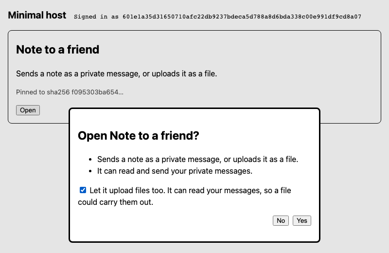
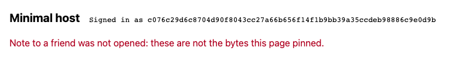
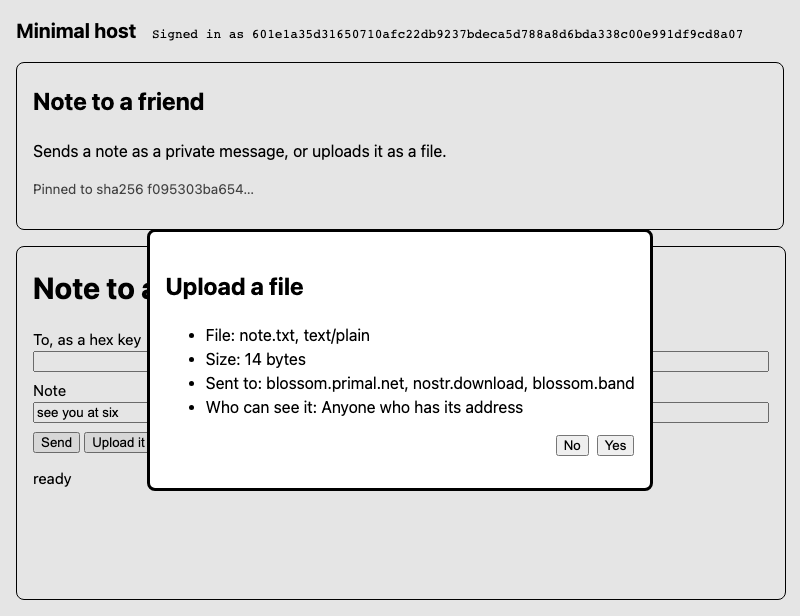
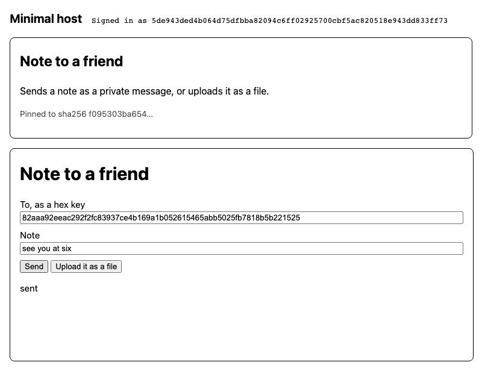

<div align="center">

# Minimal host

**A page with its own UX on kernl's kernel, built only from published packages.**

[](https://www.npmjs.com/package/@kernlize/kernel)
[](https://www.npmjs.com/package/@kernlize/modules)
[](../../LICENSE)
[](https://github.com/kernlize/web/stargazers)

</div>

<p align="center">
  
</p>

## What is this?

This host uses `@kernlize/kernel` and two modules from `@kernlize/modules`. It has no Svelte, no store and no window manager. It opens one applet, pinned by hash, and asks the person everything in its own dialog.

This example is the finished page from the [Build a shell](https://kernl.run/docs/tutorials/build-a-shell) tutorial. If a step there does not do what it says, compare with this.

## Quick start

It is not part of the pnpm workspace, so it installs from npm like anyone else's app:

```sh
cd examples/minimal-host
npm ci
npm run dev
```

Click **Sign in with a throwaway identity**, then **Open**. `npm run build` writes `dist/`, which any static server can serve.

## What it shows

### One composition call

The kernel and its modules come from one call in [`src/main.ts`](src/main.ts):

```ts
createKernel({
  host,
  builtins: [NOTE],
  modules: [messagingModule({ providers: [privateDm()] }), filesModule()],
});
```

`host` is the page's side of the contract: `storage`, the `asks` it answers, `notify`, `openLink`, `getVisibility` and `onRevoked`, which removes the frame when the kernel stops the applet.

### An applet pinned by hash

The applet is [`public/applet.html`](public/applet.html), a single-file napplet that sends a private message (`dm`) and uploads a file (`upload`). [`vite.config.ts`](vite.config.ts) hashes the file at build time, and the kernel refuses any bytes that do not hash to that pin. Serve something else at `applet.html` and the page never offers to open it:

<p align="center">
  
</p>

### Asks in the host's own dialog

The host renders `upload.file` in its own `<dialog>` ([`src/ask.ts`](src/ask.ts)), one question at a time. The kernel supplies the facts: what leaves, where it goes, and who can see it. Any other kind of question is refused without asking.

<p align="center">
  
</p>

### Messages and uploads

An applet that reads messages has uploads withheld ([D-046](https://kernl.run/docs/decisions#d-046)). The host's opening question, shown at the top with its box ticked, lets the person keep uploads anyway, and that choice is the person's alone ([D-060](https://kernl.run/docs/decisions#d-060)). The box starts unticked. Left that way, the applet's upload button answers `uploads are not offered` and nothing reaches a file server.

Once open, the applet sends its note as a private message:

<p align="center">
  
</p>

## Files

```
minimal-host/
├── public/
│   └── applet.html    the pinned napplet
├── src/
│   ├── ask.ts         the host's dialog and its question queue
│   ├── env.d.ts       types the build-time hash constant
│   ├── main.ts        the host, the kernel and the open flow
│   └── style.css
├── index.html         the page, with frame-src 'none' before any script
├── package.json
├── tsconfig.json
└── vite.config.ts     hashes applet.html into __APPLET_SHA256__
```

## Test it

[`tests/e2e/minimal-host.spec.ts`](../../tests/e2e/minimal-host.spec.ts) runs the kernel, the private-message provider and the uploader for real, against relays and file servers that exist only in the browser under test. From the repository root:

```sh
pnpm install
pnpm site:build && pnpm example:build
pnpm exec playwright test --project minimal-host
```

Playwright also starts the server for the built site in `.pages/`, so `pnpm site:build` has to run first even for this one project. Set `KERNL_PROOFS_DIR` to a directory and the spec saves six full-window screenshots there. The four in this README are `02-open-keeping-uploads`, `03-sent`, `04-upload-question` and `06-not-the-pinned-bytes`, cropped to the page column.

## Further reading

| Page | What it covers |
|---|---|
| [Build a shell](https://kernl.run/docs/tutorials/build-a-shell) | This example, step by step |
| [Render an ask](https://kernl.run/docs/how-tos/render-an-ask) | Drawing the kernel's questions in your own UI |
| [`@kernlize/kernel`](https://kernl.run/docs/packages/kernel) | What the kernel holds and what a host supplies |
| [Decisions](https://kernl.run/docs/decisions) | Why D-046 seals messaging applets and D-060 lets the person unseal them |

## Contributing

This example lives in [kernlize/web](https://github.com/kernlize/web), and changes to it follow that repository's rules in [`AGENTS.md`](../../AGENTS.md). Code and docs change in the same pull request.

<a href="https://github.com/kernlize/web/graphs/contributors">
  
</a>

## License

MIT, as the rest of the repository. See [`LICENSE`](../../LICENSE).

---

<div align="center">

[](https://star-history.com/#kernlize/web&Date)

</div>
